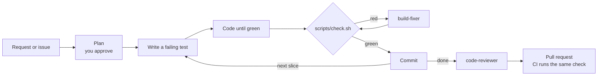

# claude-starter

[](LICENSE)
[](https://github.com/clw237/claude-starter/generate)

**A small, language-agnostic starter template for projects built with [Claude Code](https://code.claude.com/docs).**

AI coding sessions tend to drift. They guess commands, skip tests, bloat their context, and repeat
mistakes you already corrected. This template gives every new project the same set of guardrails:

- **Plan first.** Claude writes a short plan, and you approve it before any code changes.
- **Test as you go.** Work happens in small, tested slices, each one committed green.
- **One definition of done.** `scripts/check.sh` runs format, lint, types and tests. It's the same for Claude, for you and for CI.
- **Lean context.** Only essentials load every turn. Skills and rules load when they're needed.
- **Guardrails, not just guidelines.** Permissions and hooks enforce the rules that matter.

It works with any language. Python, TypeScript/JavaScript, Go, Rust, Java/Kotlin (Gradle) and C#/.NET
are detected automatically, and anything else takes a few lines in `scripts/check.sh`.

---

## Quick start

1. Click **[Use this template](https://github.com/clw237/claude-starter/generate)** to create your repository, then clone it.
2. In the project folder, start Claude Code:
   ```bash
   claude
   ```
3. Tell Claude what you're building and in which language, then run:
   ```text
   /bootstrap
   ```
   Claude scaffolds a minimal project, makes `bash scripts/check.sh` pass with a real test, and fills in
   `CLAUDE.md`. It also moves this guide to `docs/TEMPLATE.md` and writes your project's own `README.md`.
4. For every change after that:
   ```text
   /add-feature <what you want>
   ```

**Requirements:** [Claude Code](https://code.claude.com/docs), git, bash (on Windows, Git Bash, which
Claude Code uses there), and your language's toolchain. [`jq`](https://jqlang.org/) is optional.

## How work flows



## What's inside

| Path | Purpose | When it loads |
|---|---|---|
| [`CLAUDE.md`](CLAUDE.md) | Project memory: what this is, the commands, the rules that always apply | Every turn, so it stays short |
| [`.claude/rules/`](.claude/rules) | Coding style, security, testing (testing is scoped to test files with `paths:`) | Automatically, by path |
| [`.claude/skills/bootstrap`](.claude/skills/bootstrap/SKILL.md) | Choose a stack, scaffold it, wire up the check, fill in the placeholders | `/bootstrap` |
| [`.claude/skills/add-feature`](.claude/skills/add-feature/SKILL.md) | Plan, branch, test first, check, review, pull request | `/add-feature` |
| [`.claude/skills/code-challenge`](.claude/skills/code-challenge/SKILL.md) | Timeboxed workflow for interviews and take-homes, ending in a README that explains the work | `/code-challenge` |
| [`.claude/skills/handoff`](.claude/skills/handoff/SKILL.md) | When and how to start a fresh, cheaper session | `/handoff` |
| [`.claude/agents/planner.md`](.claude/agents/planner.md) | Read-only implementation plan for larger changes | Delegated |
| [`.claude/agents/code-reviewer.md`](.claude/agents/code-reviewer.md) | Read-only review that reports only findings tied to a cited line and a concrete failure | Delegated |
| [`.claude/agents/build-fixer.md`](.claude/agents/build-fixer.md) | Smallest fix for a red check, and never loosens a test | Delegated |
| [`.claude/settings.json`](.claude/settings.json) | Allows the check and basic git; asks before installs, pushes and config edits; denies force-push, `rm -rf` and reading secrets | Always |
| [`.claude/hooks/format.sh`](.claude/hooks/format.sh) | Formats each file after Claude edits it, if a formatter is installed | After every edit |
| [`scripts/check.sh`](scripts/check.sh) | The definition of done: format check, lint, types, tests | You, Claude, CI |
| [`PLAN.md`](PLAN.md) | Design doc: goal, requirements, edge cases, approach, build order | |
| [`docs/decisions/`](docs/decisions) | Short records of significant choices | |
| [`docs/claude-code-cheatsheet.md`](docs/claude-code-cheatsheet.md) | Shortcuts, commands and habits that save tokens | |
| [`.github/`](.github) | CI running `scripts/check.sh`, Dependabot for pinned actions, issue and pull request templates | |

Personal overrides that stay out of git go in `CLAUDE.local.md` and `.claude/settings.local.json`. Both are gitignored.

## Using it for a code challenge or interview

```text
/code-challenge
Time limit: 60 minutes. Here is the prompt: <paste it>
```

The skill splits your time into phases. **Understand** produces clarifying questions and edge cases.
**Set up** recommends a language and you decide. **Plan** lays out the slices. **Build** works through
them test first. **Wrap up** starts on time, even mid-slice. You finish with a README covering how to
run it, the approach, assumptions, trade-offs, next steps and how AI was used, plus a short talk
track for presenting. The skill keeps the code plain enough that you can explain every line.

## Customizing

- **Your stack:** after `/bootstrap`, `scripts/check.sh` holds the exact commands. Edit it freely. CI runs whatever it says.
- **Permissions:** add your test and lint commands to `permissions.allow` in `.claude/settings.json` so Claude stops asking about them.
- **Conventions:** put language-specific conventions in `.claude/rules/<language>.md` with a `paths:` scope.
- **Workflows:** add a skill under `.claude/skills/<name>/SKILL.md` once the same process has come up twice.
- **Corrections:** when you correct Claude and it should stick, have it edit `CLAUDE.md`, the rule or the skill in place.

## Principles

1. **Don't overcomplicate.** Configuration is fine-tuning, not architecture. Grow the setup only when a need repeats.
2. **Context is precious.** Keep always-loaded text minimal, and start fresh sessions between unrelated tasks.
3. **Verify, don't trust.** Nothing is done until the check is green and you've read the diff.
4. **Enforce what matters.** If a rule must never be broken, make it a permission or a hook, not a sentence.

## FAQ

**Does it work without GitHub?** Yes. Everything except `.github/` works locally with plain git.

**I use another language.** Run `/bootstrap`. If the check script doesn't detect your stack, Claude
writes the exact commands into `scripts/check.sh`.

**Why does `scripts/check.sh` fail on a fresh copy?** There's no project yet. It tells you to run
bootstrap. CI skips the check until a project manifest exists, so the template itself stays green.

**Can I use only part of it?** Yes. Each file stands alone. Copy the `.claude/` folder and
`scripts/check.sh` into an existing repository, then run `/bootstrap` to adapt them.

## Contributing

Issues and pull requests are welcome, especially stack recipes for `bootstrap` and `scripts/check.sh`,
and fixes that keep the template small. Please keep changes language-agnostic and explain the
problem they solve. Versions are tagged in the [releases](https://github.com/clw237/claude-starter/releases).

## Credits

Several patterns are adapted from [affaan-m/ECC](https://github.com/affaan-m/ECC) (MIT):
- A lean memory file, with modular rules alongside it.
- Subagents scoped to specific tasks, mostly read-only.
- The reviewer's confidence gate.
- Formatting hooks that run after each edit.
- Compacting at strategic moments.

This template keeps a deliberately small core instead of ECC's full catalogue.

## License

[MIT](LICENSE)
